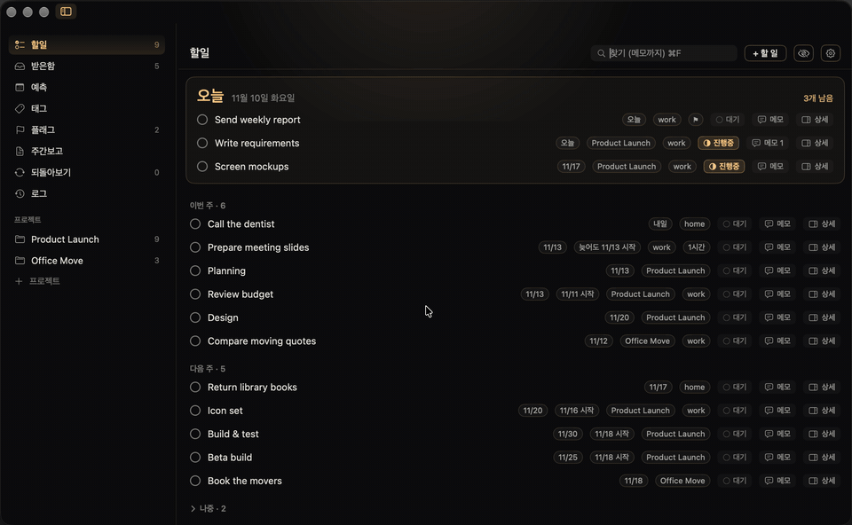

  

<h1 align="center">SHAMUS 2</h1>

  <b>A one-line launcher for macOS, with a detective theme.</b> 
  Press a shortcut, type one line, and SHAMUS finds, calculates, translates or runs it.

  

SHAMUS ("shamus" is old slang for a detective) lives in the menu bar and has no Dock icon. One shortcut opens a single input line under the notch. Type what you want: an app name, a file, a sum, an amount of money, a sentence to translate. SHAMUS works out where to look and shows the result in the same panel.

> **Language:** the app's interface and most commands are in Korean. Keywords such as `할일` (to-do), `맥` (Mac) and `영어로` (into English) are listed with their meanings below.

---

## Contents

- [Main features](#main-features)
- [Requirements](#requirements)
- [Install](#install)
- [User guide](#user-guide)
  - [The launcher](#1-the-launcher)
  - [The super button](#2-the-super-button)
  - [To-do manager](#3-to-do-manager)
  - [The detective pet](#4-the-detective-pet)
  - [Meeting recorder](#5-meeting-recorder)
  - [Photo and video editor](#6-photo-and-video-editor)
- [Keyboard reference](#keyboard-reference)
- [Privacy](#privacy)
- [Updates](#updates)

---

## Main features

| | Feature | What it does |
|---|---|---|
| 🔎 | **One-line launcher** | Apps, files (including text inside files), images and screenshots (including text inside images), contacts, calendar, Google search |
| 🧮 | **Instant answers** | Calculator and currency conversion appear as you type, with no Enter needed |
| 🌐 | **Translation** | On-device translation. Type `… 영어로` ("… into English") or paste foreign text |
| 🖥 | **Mac commands** | Type `맥` for screen saver, lock, sleep, dark mode, sound output, network location and more |
| ✅ | **To-do manager** | Projects, tags, flags, due dates, repeats, a forecast, a WBS timeline and a weekly report draft |
| 🕵️ | **Detective pet** | A desktop companion with 7 characters and 12 poses that reacts to what you are doing. It also holds files for you |
| 🎙 | **Meeting recorder** | Records meetings, transcribes them on your Mac, splits speakers and helps write minutes *(off by default)* |
| 🖼 | **Photo and video editor** | Batch resize, crop, filters, text, stickers, plus a vertical (9:16) video editor with auto-subtitles |
| 🤖 | **On-device AI** | Understands plain sentences with Apple's built-in model, or an optional in-app model you download |

---

## Requirements

- A Mac with Apple silicon
- **macOS 26 or later**
- For AI sentence understanding: Apple Intelligence turned on (System Settings), or the optional in-app AI engine

---

## Install

SHAMUS is shared with our team as a ready-made app. The source code is kept in a separate private repository.

1. Open the [**Releases**](https://github.com/ReviKim/SHAMUS-releases/releases) page and download the latest `SHAMUS-2-x.y.z.zip`.
2. Unzip it and move **SHAMUS 2.app** into your **Applications** folder.
3. The first time only, **right-click the app → Open**, then click **Open** again. macOS asks this because the app was not downloaded from the App Store.
4. A welcome window shows the shortcut (**⌥ Space**). Features that need access to Contacts, Calendar or Reminders ask for it the first time you use them, and you can manage them in Settings.

> No release has been published yet. The first one is coming soon.

---

## User guide

### 1. The launcher

Press **⌥ Space** to open the input line. Press **Esc** or the shortcut again to close it. You can change the shortcut in **Settings › General**.

> If another app (such as ChatGPT) also uses ⌥ Space, the app that started last takes the shortcut. Change one of the two.

Commands work **as soon as you type them**. For anything else, type and press **Enter**. If more than one place could answer, chips appear under the line. Pick one with **← →** and press Enter.

| Type this | What happens |
|---|---|
| `12*3+4`, `(1200+350)*3-40%`, `sqrt(16)` | Calculator result, Enter copies it |
| `100달러` ($100), `5만원` (₩50,000) | Currency conversion, with the time the rate was fetched |
| `안녕하세요 영어로` ("hello into English"), `hello` | On-device translation, Enter copies it |
| `카카오`, `safari` | Finds and launches the app |
| `지난주 견적 pdf` (last week's quote pdf) | File search with plain-language conditions |
| `내용 계약 해지` (content: contract cancellation) | Searches **inside** files and shows the matching sentence |
| `스크린샷` (screenshot), `이미지 로고` (image logo) | Image grid. Words after it also search text inside images |
| `맥` (Mac) | Screen saver, lock, display off, sleep, log out, restart, dark mode, mute… |
| `사운드 출력` (sound output) | Switch the audio output device |
| `네트워크 위치` (network location) | Switch between saved network locations |
| `> uptime`, `명령어 ls -la` | Runs a Terminal command (⌥ Enter shows a short result inline) |
| `할일` (to-do) + Enter | Opens the to-do manager |
| `할일2 Write report #Work 다음주` | Adds a to-do with project, tag and date |
| `메모 idea…` (memo) | Appends a note to `~/Documents/SHAMUS-메모/메모.md` |
| `시트` (sheet) | Looks up rows in your registered Google Sheets |

If you close the launcher and open it again within 30 seconds, your last search is still there. You can change this time in Settings.

### 2. The super button

  

The detective-hat button at the right end of the input line opens every tool in one grid: **Record, Minutes, Music, To-do, Memo, Editor, Mac, Translate and Commands**. It changes shape when something is happening. During a recording it shows a red dot and a timer. While music plays it shows moving sound bars. Click it to open the related controls.

### 3. To-do manager

  

Open it by typing `할일` + Enter in the launcher, from the super button, or from the menu bar icon. The number next to the menu bar icon is how many tasks you have today.

**Adding tasks.** Press **⌘N** or **+ 할 일** and write everything on one line:

| Token | Meaning | Example |
|---|---|---|
| `#name` | project | `#Product Launch` |
| `@name` | tag | `@home` |
| `!` | flag | `Pay rent !` |
| `내일`, `다음주`, `11/20` | tomorrow, next week, a date | `Call the bank 내일 3시` (tomorrow 3 pm) |
| `마감 11/20`, `시작 11/18` | due date, start date | |
| `매주`, `2주마다` | every week, every 2 weeks | |
| `~30분` | estimated time (30 min) | |

**Views (left sidebar)**

- **할일 (To-do)**: today in a large card, then this week and next week
- **받은함 (Inbox)**: tasks without a project
- **예측 (Forecast)**: day, week or month, with your calendar events if you want them
- **태그 · 플래그 (Tags · Flagged)**
- **주간보고 (Weekly report)**: builds a draft from what you finished and what is in progress. Edit it and copy it.
- **되돌아보기 (Review)**: go through projects one by one
- **로그 (Log)**: everything you finished
- **Projects**: a list view, or a **WBS** timeline where you drag bars to change dates

**Good to know**

- 👁 The **eye button** shows or hides finished tasks. By default they are hidden. The log always keeps them.
- ⚙️ The **gear button** opens the to-do settings.
- Each task has a status chip: **대기** (waiting), **진행중** (in progress) or done. Notes on a task can be marked for the weekly report.
- Tasks can be sent to Calendar or Reminders. You can import from and sync with Reminders, and export everything to CSV.
- **⌘F** searches titles and notes. **⌘Z** undoes your last change.

### 4. The detective pet

  
  &nbsp;&nbsp;
  

Turn it on in **Settings › Pet** (it is off by default). There are seven characters: boy detective, girl detective, man detective, woman detective, detective dog, black cat and detective robot. Hover over a character card in Settings to preview its poses. The size slider changes each character's size.

The pet changes pose with what is happening:

| Pose | When |
|---|---|
| Idle · Walking · Looking around | Normal. It strolls, and turns when the pointer comes near |
| Working | Transcribing, downloading, other jobs running |
| Thinking | Waiting for an AI answer |
| Catching a file | You drag a file over it |
| Running | You start dragging a file, so it runs over to catch it |
| Alert · Done | A deadline reminder · a job finished |
| Being carried | You pick the pet up with the mouse |
| Recording | A meeting is being recorded |
| Sleeping | Nothing has happened for 3 minutes |

**The pet's file shelf.** Drop files on the pet to keep them for later. If you drop several files at once, they become **one bundle**, and dragging the bundle out moves all of them together. Click a tile to show an ✕ that removes it. Removed copies go to the Trash, never straight to deletion.

**Your own pet.** Put images in `~/Pictures/SHAMUS 펫/`, either one image or a folder with one image per pose (for example `쉬는중.png` for idle and `달리기.gif` for running). It appears in the character list.

### 5. Meeting recorder

Off by default. Turn it on in **Settings › General › Meeting recording**.

1. Press the super button and choose **Record**, or type `회의 시작` (start meeting) and press Enter.
2. When you stop, SHAMUS transcribes the audio **on your Mac** and labels speakers (Speaker 1, Speaker 2…). You can pick the speech engine: Qwen3-ASR 1.7B (quality), 0.6B (speed) or the macOS built-in engine.
3. In the transcript editor you can rename and merge speakers, listen to any line, fix text, find and replace.
4. **Minutes**: choose the meeting type, copy a ready-made prompt to paste into the AI of your choice, paste the answer back, edit it, then copy it or save it as text. Action items can be sent straight to the to-do manager.

### 6. Photo and video editor

Type `편집기` (editor) or use the super button.

- **Photos**: drop many images at once. Rotate, flip, resize, remove the background and convert the format for all of them. Crop, color curves, dozens of filters (including film looks), text boxes, drawing, stickers, retouch and masks for single images. You can also make collages, GIFs, slices and document scans.
- **Video**: a 9:16 timeline with three video tracks, text and sticker tracks, 26 transitions, speed curves, sound effects and music that ducks under speech. Auto-subtitles are made on-device. Saves as MP4 (1080×1920) and supports templates.
- Your originals are never overwritten. Results are saved as new files.

---

## Keyboard reference

| Key | In the launcher results |
|---|---|
| **↑ ↓** | Move the selection |
| **← →** | Pick where to search (chips) |
| **Enter** | Open / run / copy the answer |
| **⇧ Enter** | Copy (file path, phone number, task title…) |
| **⌘ Enter** | Reveal the file in Finder |
| **⌥ Enter** | Edit the image (or uninstall, for an app) |
| **Space** | Quick Look preview |
| **⌘[ ⌘]** | Switch the file-type chip |
| **Esc** | Back / close |

---

## Privacy

Most features run **entirely on your Mac**: file and image search (Spotlight and on-device text recognition), translation, the calculator, AI sentence understanding, transcription and speaker separation. Search words and file contents are not sent anywhere.

These features use the internet, and only for what they need:

- **Google search** opens your browser with the search words
- **Currency rates** are refreshed from open.er-api.com at most every 6 hours (only currency codes are sent)
- **Google Sheets** lookups talk to Google with your own sign-in
- **Downloads**: translation languages and optional AI or speech models, each downloaded once

Passwords and tokens are stored only in the macOS **Keychain**.

---

## Updates

New versions are published on the [Releases](https://github.com/ReviKim/SHAMUS-releases/releases) page. An in-app update check is on the way. Once it is in, SHAMUS will tell you when a new version is out and install it for you.
